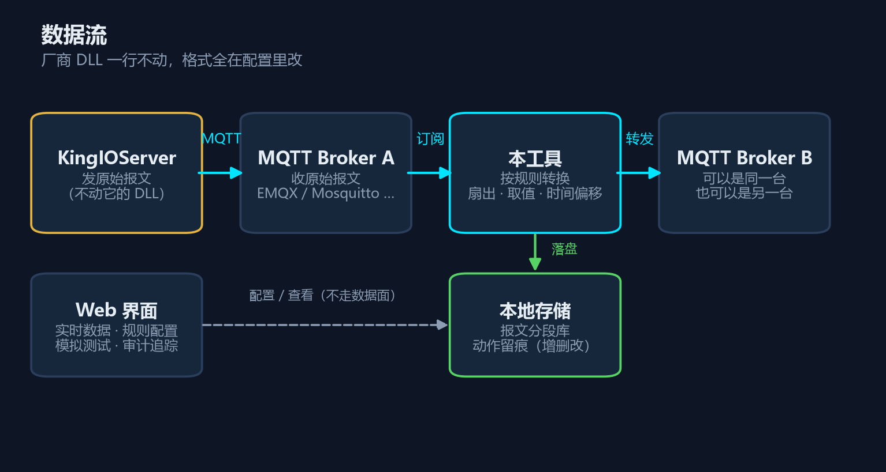
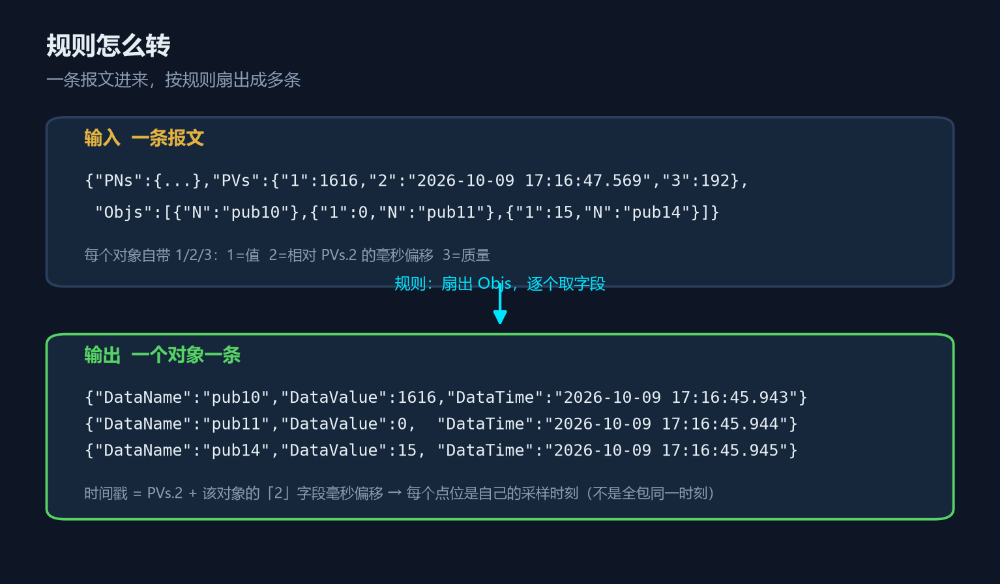
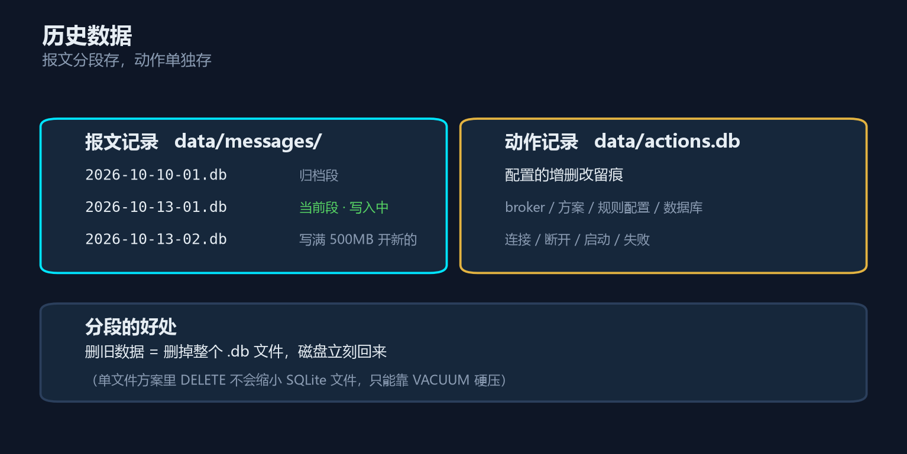

# MQTT 报文转换 / 转发工具

<sub>共产 · 共和 · 大同</sub>

> 把 MQTT 上的报文按规则改写成你想要的格式，再转发出去。
> **不动厂商 DLL，格式全在配置文件里改。**



---

## 它解决什么问题

很多工控软件（例如 KingIOServer）通过 MQTT 往外发数据，但**发出来的报文格式是厂商定的**，你要的格式是另一套。常见三条路：

| 做法 | 问题 |
|---|---|
| **改厂商 DLL** | 厂商升级一覆盖就废；只能管一条路；每改一次格式都要重新逆向 |
| **等厂商开发** | 排期不可控；他们按自己的节奏 |
| **自己做个转换器** | ← 就是这个工具 |

它夹在两个 MQTT 中间：**订阅 → 按规则转换 → 转发**。格式改坏了改配置就行，不用重新编译、不用碰厂商文件。

一条报文进来，可以**扇出**成多条（一个变量一条），可以取任意字段、做算术、按规则分流。



---

## 能干什么

- **规则配置**：模板引擎，支持取值、多路回落、毫秒偏移时间戳、**用变量名当输出的键**
- **多方案并行**：一个监听可绑多个目标，每个目标绑不同规则；也可以做**双向**（A→B 和 B→A 同时跑）
- **Web 界面**：实时数据、配置 broker、规则配置、方案配置、模拟测试、审计追踪，六个页面
- **模拟测试**：离线试算（不碰 broker）+ 在线真发真收（走完整条链路）
- **历史数据**：报文分段存储、配置的增删改留痕
- **零第三方依赖**：只用 Python 标准库，不用 pip install 任何东西

---

## 快速开始

### 1. 环境

| 需要 | 说明 |
|---|---|
| **Python 3.12+** | [python.org](https://www.python.org/downloads/) 下载安装，装的时候勾上 *Add to PATH* |
| **一个 MQTT broker** | EMQX / Mosquitto / HiveMQ 都行，本地或远程都可以 |
| **Windows** | 启动脚本是 `.bat`；Mac/Linux 用 `python 震/launch.py webui` |

> **不装任何第三方库**。整个工具只用 Python 自带的模块。

### 2. 启动

**双击 `震\启动WebUI.bat`**

服务在**后台**跑，不占黑窗。稍等两秒浏览器自动打开 `http://127.0.0.1:8090/`。

| 想做什么 | 怎么做 |
|---|---|
| 看它在不在跑 | 双击 `巽\状态.bat`，或看界面左上角标题（绿闪=正常，灰=掉线） |
| 停止 | 双击 `巽\停止.bat`，或在「系统设置」里点停止转发 |
| 管转发（启/停/重建） | 界面「系统设置」页 |
| 体检 + 自动修 | 界面「系统设置」→ 自动修复 |

命令行等价：

```bash
python 震/launch.py webui        # 前台跑，看得见日志
python 震/launch.py webui 8090 --bg   # 后台跑，不占窗
python 震/launch.py reshaper     # 只转发，不开界面
```

### 3. 填配置

仓库里带的是**示例配置**，里面是占位符。复制一份并填上你自己的账号：

```bash
cd 乾/2运势
copy reshape.example.json reshape.json     # Windows
# cp reshape.example.json reshape.json     # Mac / Linux
```

打开 `reshape.json`，把 `改成你的用户名` / `改成你的密码` 换掉。

> 🔒 **`reshape.json` 含账号密码，已在 `.gitignore` 里，不会进版本库。**
> 想改格式也可以直接编辑它，改完重启服务生效。

### 4. 三步配好

打开页面后，按顺序走：

**① 配置 broker** —— 告诉它连谁

```
名称     比如「本地EMQX」
broker IP   127.0.0.1          ← 只填 IP，端口填下一栏
端口号      1883
用户名/密码  你的账号
主题        kingscada
```

点 **测试通路**，变绿就通了。然后 **保存**。

> 💡 IP 栏里填 `127.0.0.1:1883` 也行，会自动把端口拆到下一栏。

**② 规则配置** —— 告诉它怎么转

点 **+ 新增规则**，填三样：匹配条件、扇出、输出字段。下面「规则怎么写」一节有完整例子。

**③ 方案配置** —— 把前两步串起来

点 **+ 新建方案**，选监听哪个 broker、转发到哪个 broker、用哪几条规则，保存并运行。

回到「实时数据」页，就能看到报文在跑了。

---

## 界面介绍

| 页面 | 干什么 |
|---|---|
| **实时数据** | 左边原始报文、右边转换结果，点左边某一条看它是怎么转出来的。顶上四个计数：收到 / 转发 / 解析失败 / 发布失败 |
| **配置broker** | 存连接信息（IP、端口、账号、主题）。**这里不区分监听还是目标** —— 同一个 broker 可以在方案甲里当监听、在方案乙里当目标 |
| **规则配置** | 管转换规则。点一行展开看完整内容，可编辑 / **复制** / 删除 |
| **方案配置** | 管转发方案：谁监听、扇出到谁、用哪些规则。可新建 / 运行 / 停止 / 复制 |
| **模拟测试** | **离线转换测试**（只算模板，不发消息）+ **在线转换测试**（真发真收，走完整条链路） |
| **审计追踪** | **报文记录**（每条进出的报文）/ **动作记录**（配置的增删改留痕）/ **存储管理**（分段、容量、手动清除） |
| **系统设置** | 状态检测 / 自动修复 / 启动·停止·重建转发 |

> **左上角「MQTT 转发」标题是个心跳指示灯**：绿→青渐变在闪 = 服务正常；变灰 = 连不上后端（服务没在跑）。
> 标题**点一下会重建转发连接**（改完配置点它生效）—— 注意这只重连 MQTT，不是重启整个程序。

---

## 怎么看它在不在跑

**双击 `巽\状态.bat`**，一屏看清：

```
============================================================
  MQTT 转发 · 运行状态          2026-10-15 08:58:54
============================================================
  Web 控制台   8090   OK  在线   （已运行 12 分 17 秒）
  MQTT Broker  1883   OK  在线

  方案运行情况
    方案一        OK   监听OK  目标OK   收 1234 转 1234 解析失败 0 发布失败 0

  报文库       4 段 / 135.2 MB   共 616869 条
  动作记录     320 条 / 1.67 MB

  最近报文     OK  3 秒前
------------------------------------------------------------
  一切正常
------------------------------------------------------------
```

出问题时它会直接告诉你**怎么办**：

```
  Web 控制台   8090   FAIL 离线
------------------------------------------------------------
  发现 1 个问题：
   · Web 控制台没在跑 —— 双击 震\启动WebUI.bat 启动
------------------------------------------------------------
```

> 服务没起时它也能看 —— 会直接去读数据文件，告诉你最后一次写入是多久前。

**最常见的一种「服务没了」**：你是用 `震\启动WebUI.bat` 启动的，那个黑窗口**就是**服务。**关掉窗口 = 服务停止**。电脑重启也会停，所以重启后要再双击一次。

---

## 核心概念

理解这三个词，剩下的都是填表：

```
broker   =  连接信息：连谁、怎么连
规则     =  转换逻辑：怎么拆、怎么取、输出什么
方案     =  串起来：从哪个 broker 的哪个主题收，按哪几条规则转，发到哪个 broker 的哪个主题
```

**多个方案可以同时跑。** 例如双向转换：

```
方案1   监听 kingscada  ──规则A──▶  MES
方案2   监听 MES       ──规则B──▶  kingscada
```

---

## 规则怎么写

一条规则有四样东西：

| 字段 | 作用 | 必填 |
|---|---|---|
| **规则名称** | 方案里按名字勾选它 | ✅ |
| **匹配条件** | 报文里必须能取到它，规则才生效。留空 = 所有报文都用 | |
| **扇出** | 对数组/对象逐元素发一条。留空 = 整包一条 | |
| **输出字段** | 输出的 JSON 长什么样 | ✅ |
| **示例报文** | 模拟测试时自动填进输入框 | |

### 取值语法

| 写法 | 含义 | 例 |
|---|---|---|
| `@PVs.1` | 取 `payload["PVs"]["1"]` | 深入报文任意层级 |
| `@Objs.0.N` | 数组按下标取 | `payload["Objs"][0]["N"]` |
| `@.` | 报文本身 | 配合「扇出」用 |
| `@#key` | 当前元素的键 | 扇出对象时 |
| `@#value` | 当前元素的值 | |
| `@#value.N` | 当前元素的 `.N` 字段 | |
| `@#index` | 当前下标 / 键名 | |
| `@#now` | 当前时间 `YYYY-MM-DD HH:MM:SS.mmm` | |
| `@#ts` | **有效时间戳** = `PVs.2` + 本元素 `2` 字段的毫秒偏移 | 见下方说明 |
| `@a\|b\|c` | 依次回落，取到哪个用哪个 | |
| 其他 | 原样输出的字面量 | |

**字段名也可以写 `@`** —— 用变量名直接当输出的键，例如下面的例三。

### `@#ts` 为什么要单独一个

有些软件（例如 KingIOServer 的 kxMQTT）发的报文里，每个变量的时间戳**不是独立字段**，而是相对包时间戳的**毫秒偏移量**：

```json
{ "PVs": { "2": "2026-10-10 17:04:27.663" },
  "Objs": [ {"N":"pub10", "2":-1626}, {"N":"pub11", "2":-1625} ] }
```

`pub10` 的真实时间是 `17:04:26.037`，`pub11` 是 `17:04:26.038` —— 逐点扫描，各差 1 毫秒。

写 `@PVs.2` 会把全包变量都打成同一个时刻；写 `@#ts` 才是每个点位自己的采样时刻。

### 例一：拆数组，一变量一条

**输入**

```json
{
  "PNs": {"1": "V", "2": "T", "3": "Q"},
  "PVs": {"1": 1616, "2": "2026-10-09 17:16:47.569", "3": 192},
  "Objs": [{"N": "pub10"}, {"1": 0, "N": "pub11"}, {"1": 15, "N": "pub14"}]
}
```

**规则**

| 字段名 | 值 |
|---|---|
| 匹配条件 | `@PNs` |
| 扇出 | `@Objs` |

| 输出字段名 | 值 |
|---|---|
| `DataName` | `@#value.N` |
| `DataValue` | `@#value.1\|PVs.1` |
| `DataTime` | `@#ts` |
| `DataQuality` | `@#value.3\|PVs.3` |

**输出**（三条）

```json
{"DataName":"pub10","DataValue":1616,"DataTime":"2026-10-09 17:16:47.569","DataQuality":192}
{"DataName":"pub11","DataValue":0,  "DataTime":"2026-10-09 17:16:47.569","DataQuality":192}
{"DataName":"pub14","DataValue":15, "DataTime":"2026-10-09 17:16:47.569","DataQuality":192}
```

> `@#value.1|PVs.1` 的意思是：先取对象自己的 `1` 字段，取不到就用 `PVs.1`。
> 因为报文里「等于基准值的字段会被省略」，省略了就代表它等于基准值。

### 例二：扁平报文，逐个键发一条

**输入**

```json
{"tag1": 0, "tag2": 0, "tag3": 0}
```

**规则**

| 字段名 | 值 |
|---|---|
| 匹配条件 | `@tag1` |
| 扇出 | `@.` |

| 输出字段名 | 值 |
|---|---|
| `DataName` | `@#key` |
| `DataValue` | `@#value` |
| `DataTime` | `@#now` |

**输出**（三条）

```json
{"DataName":"tag1","DataValue":0,"DataTime":"2026-10-13 15:00:00.123"}
{"DataName":"tag2","DataValue":0,"DataTime":"2026-10-13 15:00:00.123"}
{"DataName":"tag3","DataValue":0,"DataTime":"2026-10-13 15:00:00.123"}
```

> 匹配条件写 `@tag1|/tag1` 更保险 —— 有些工程里键名带前导斜杠，两个都试。

### 例三：变量名直接当键

**输入** 同例一。

**规则**：扇出 `@Objs`

| 输出字段名 | 值 |
|---|---|
| `@#value.N` | `@#value.1\|PVs.1` |

注意**字段名本身写了 `@`**，它会从报文里取出来当键。

**输出**

```json
{"pub10": 1616}
{"pub11": 0}
{"pub14": 15}
```

左边是变量名，右边是它的值 —— 一步到位，不用再包一层。

---

## 配置文件

`乾/2运势/reshape.json` 就是全部配置。界面改完会自动写回去；想直接编辑也行，改完重启服务生效。

> 仓库里带的是 `reshape.example.json`（占位符）。第一次跑要复制成 `reshape.json` 再填自己的账号 —— 真配置含密码，不进版本库。

```jsonc
{
  "brokers": {                  // 连接信息池，按名字引用
    "本地EMQX": {
      "host": "127.0.0.1", "port": 1883,
      "username": "admin", "password": "xxx",
      "topic": "kingscada"
    }
  },
  "rule_library": {             // 规则库，按名字引用
    "拆分规则": {
      "match": "@PNs",          // 匹配条件
      "each": "@Objs",          // 扇出
      "sample": { ... },        // 示例报文（模拟测试用）
      "template": { "DataName": "@#value.N" }   // 输出字段
    }
  },
  "routes": [                   // 方案
    {
      "name": "方案一",
      "enabled": true,
      "from":    { "broker": "本地EMQX", "topics": ["kingscada"], "qos": 0 },
      "targets": [{ "broker": "本地EMQX", "topic": "MES",
                    "qos": 0, "retain": false,
                    "rules": ["拆分规则"] }]
    }
  ],
  "omit_missing": true,         // 取不到的字段直接省略
  "log_file": "巽/kio_reshaper.log"
}
```

`from` 是**监听**（数据从哪来），`targets` 是**目标**（转换结果发到哪，可多个）。

---

## 历史数据



**报文记录**分段存，`坤/messages/` 下一个段一个文件，文件名 `yyyy-mm-dd-序号.db`。两个条件谁先到谁触发开新库：

| 条件 | 默认 | 可改 |
|---|---|---|
| 存储上限 | 500 MB | ✅ |
| 分段周期 | 1 天 | ✅ |

**动作记录**单独一个文件 `坤/actions.db`，记录配置的每次**增删改**（broker / 方案 / 规则配置 / 数据库）和连接运行事件。改动是**在服务端按名字对出来的**，不管你从界面哪改都会留痕。

**旧数据不自动删**，库多了去「审计追踪 → 存储管理」手动删。

> 为什么分段：单文件方案里 `DELETE` 不会缩小 SQLite 文件（空页留着复用），只能靠 VACUUM 硬压。分段之后删旧数据 = 删掉整个 `.db` 文件，磁盘立刻回来。

---

## 目录结构

```
├── 乾/            主体
│   ├── 2运势/      运行代码与配置
│   ├── 3造势/      工具与测试
│   └── 4凝势/      文档
├── 震/            启动入口（bat + launch.py）
├── 巽/            运维工具
├── 坤/            数据（报文分段 + 动作记录）
└── docs/          README 用的示意图
```

> 目录名取自八卦，是这套工具的分层约定：**乾=主体、震=入口、巽=运维、坤=数据**。
> 不影响使用，纯粹是为了「改启动方式不该动转格式逻辑」这种事分开管。

---

## 常见问题

**Q：测试通路报「IP / 域名无法解析」**
IP 栏里填成 `192.168.1.100:1883` 了。端口要填在「端口号」栏。（现在会自动拆开，但如果你用的是旧版本就手动分开填。）

**Q：测试通路报「用户名或密码错误」**
先点密码框右边的**小眼睛**看看密码对不对，多半是少打或打错一个字符。也确认用户名大小写。

**Q：实时数据页一直显示「摸鱼中」**
说明监听主题没收到东西。检查：① 方案是不是点了「运行」；② 监听主题名对不对；③ 那个 broker 上真的有人发吗。

**Q：转换结果是 0 条**
规则的**匹配条件**没命中这条报文。用「模拟测试 → 离线转换测试」粘贴真实报文试算，看是哪条规则没匹配上。

**Q：改了配置没生效**
点左上角「MQTT 转发」标题重启服务。或者改完配置页会自动落盘，但连接要重建才生效。

**Q：`.bat` 双击闪退 / 报「拒绝访问」**
确认装了 Python 并且勾了 *Add to PATH*。脚本里**不能写中文和嵌套引号的 `start`**（cmd 按 ANSI 码页解析），所以中文路径都由 `launch.py` 处理。

**Q：日志在哪**
`巽/kio_reshaper.log`。超过 5 MB 自动轮转，留最近 3 份。

**Q：能跑在 Linux / Mac 上吗**
核心代码是纯 Python，可以。用 `python 震/launch.py webui` 启动即可，`.bat` 只是 Windows 的跳板。

---

## 开发者

测试脚本在 `乾/3造势/`，改完代码跑一遍，防止把以前好的弄坏：

```bash
cd 乾/3造势
python test_direct.py       # 规则转换（含动态字段名）
python test_simtest.py      # 按规则试算
python test_storage.py      # 分段存储
python test_stability.py    # 连接超时 / 死连接 / 包上限
python test_actions.py      # 增删改留痕
python test_ts.py           # @#ts 时间偏移
node check_save.js ../2运势/webui.html   # 前端：保存 / 展开 / 复制 / 小眼睛
```

`test_ping.py` / `test_persist.py` / `test_pwd.py` 需要 Web 控制台在跑。

自检脚本：

```bash
node checkjs.js ../2运势/webui.html x.js   # JS 语法
node smoke.js ../2运势/webui.html          # 渲染函数冒烟
```

架构说明见 [`乾/4凝势/README.md`](乾/4凝势/README.md)。

---

## 为什么不用改 DLL

项目早期真的动手改过厂商 DLL（反汇编定位字符串 + 指针重定向 + 代码洞跳板），技术上可行，但不划算：

- 只能管一条路，另一条发布路径管不到
- 每改一次格式都要重新逆向
- 厂商升级直接覆盖，补丁全废
- 要处理槽位宽度、寄存器复用等细节

已回滚为原厂。逆向结论留在脚本里备查。**结论：格式让配置管，别跟二进制较劲。**

---

## English

**MQTT payload reshaper / forwarder.** Sits between two MQTT brokers: subscribes to a topic, rewrites each message into the JSON shape you want (fan-out, field extraction, timestamp arithmetic, dynamic keys), and publishes to another topic.

- Zero third-party dependencies — Python standard library only
- Rules are configuration, not code: change the format without recompiling
- Multiple routes run in parallel; supports bidirectional forwarding
- Web console for live data, rules, schemes, offline/online testing and audit trail

**Quick start:** install Python 3.12+, double-click `震\启动WebUI.bat`, open `http://127.0.0.1:8090/`.

Full documentation is in Chinese — see above.

---

## 许可与使用场景

**GPL-3.0**（全文见 [`LICENSE`](LICENSE)）。

| 你打算怎么用 | 可以吗 |
|---|---|
| 自己用 / 学习 / 研究 | ✅ 随便 |
| **拿去赚钱** | ✅ **可以** |
| **抄走闭源去卖** | ❌ **不行** —— 用了它，你的改动也必须同样开源 |

**拜托一件事**：你用在什么场景，开个 [Issue](../../issues) 或发邮件告诉我一声。

不为别的 —— 我会按真实场景继续改进它。你踩到的坑，别人也会踩到；你想让它多干的活，多半别人也想。

---

*工具是拿来用的，不是拿来看的。有问题提 Issue。*
